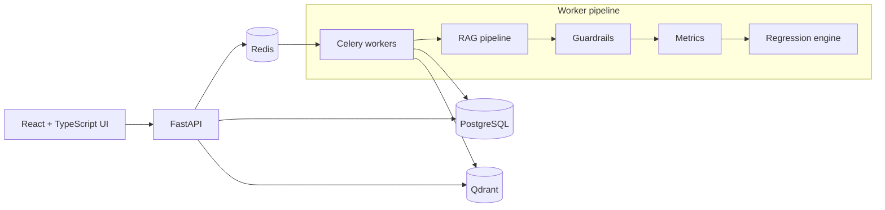

# RAGGuard

**Regression-safe evaluation and guardrails platform for Retrieval-Augmented Generation (RAG) systems.**

[](https://github.com/Visheshmak/RAGGuardrail-Project/actions/workflows/ci.yml)


RAGGuard treats a RAG pipeline like any other piece of production software: every change to prompts, chunking, embeddings, or models is evaluated against a golden dataset, compared with the last known-good baseline, and **blocked from release if quality regresses**. Input and output guardrails catch prompt injection, system-prompt leakage, PII, unsafe content, and ungrounded answers.

## Highlights

| Area | What it does |
| --- | --- |
| **RAG pipeline** | PDF/DOCX/text ingestion → recursive chunking (configurable size/overlap) → embeddings → Qdrant vector search → grounded answer generation with citations |
| **Evaluation engine** | Runs a dataset of question/expected-answer pairs and scores **accuracy**, **retrieval recall**, **faithfulness** (hallucination check), and **answer relevance** |
| **Regression gating** | Compares a candidate run against a baseline with per-metric minimums and max-allowed regression; returns `PASS` / `WARNING` / `BLOCK` |
| **Guardrails pipeline** | Pluggable checks: `prompt_injection`, `prompt_leakage`, `pii_detection` (with masking), `safety`, `grounding`; per-project policies with severity and actions |
| **Async processing** | Long-running evaluations run on Celery workers with Redis as broker |
| **Multi-tenant app** | JWT auth, projects, documents, datasets, evaluation history, guardrail settings, and an interactive playground |
| **Pluggable providers** | OpenAI embeddings/LLM, or deterministic mock providers for offline development and tests |

## Architecture



More detail in [docs/architecture.md](docs/architecture.md).

## Release gating example

`scripts/demo_regression_gating.py` reproduces a real gate decision without any external services:

```text
$ python scripts/demo_regression_gating.py
...
    - safety             | Base: 1.00 | Current: 0.99 | Reg: 0.01 (Allowed: 0.01) | Status: WARNING
    - retrieval_recall   | Base: 0.93 | Current: 0.81 | Reg: 0.12 (Allowed: 0.05) | Status: FAIL
    - faithfulness       | Base: 0.95 | Current: 0.88 | Reg: 0.07 (Allowed: 0.03) | Status: FAIL
    - accuracy           | Base: 0.93 | Current: 0.81 | Reg: 0.12 (Allowed: 0.05) | Status: FAIL

>>> DEMO SUCCEEDED: System successfully detected 12% regression and BLOCKED release! <<<
```

Default thresholds (`backend/app/evaluation/regression.py`, overridable per project):

| Metric | Minimum | Max regression |
| --- | --- | --- |
| accuracy | 0.90 | 0.03 |
| faithfulness | 0.90 | 0.03 |
| retrieval_recall | 0.85 | 0.05 |
| safety | 0.98 | 0.01 |

## Tech stack

- **Backend:** Python 3.12, FastAPI, SQLAlchemy 2.0 (async), Alembic, Pydantic, Celery
- **Frontend:** React, TypeScript, Vite, Tailwind CSS, shadcn/ui, TanStack Query
- **Data & infra:** PostgreSQL, Redis, Qdrant, Docker Compose
- **Quality:** pytest (75 tests), GitHub Actions CI

## Getting started

### Prerequisites

- Docker and Docker Compose
- Node.js 20+ and Python 3.12+ (for running outside Docker)

### Run with Docker

```bash
cp .env.example .env
make build      # docker compose up --build -d
make migrate    # alembic upgrade head
```

| Service | URL |
| --- | --- |
| Frontend | http://localhost:5173 |
| Backend API | http://localhost:8000 |
| OpenAPI docs | http://localhost:8000/docs |

Sample data: `scripts/seed_documents.py` and `scripts/seed_datasets.py` import the backend package directly. Run them from the backend virtualenv (see below) with `DATABASE_URL` pointing at the running PostgreSQL.

Leave `OPENAI_API_KEY` unset to use the built-in mock embedding and LLM providers.

### Run tests locally

```bash
cd backend
python -m venv .venv && source .venv/bin/activate
pip install -r requirements.txt
pytest -q
```

```bash
cd frontend
npm ci
npm run build
```

## Project structure

```text
backend/
  app/
    api/v1/        REST endpoints: auth, projects, documents, datasets, rag, evaluations, guardrails
    rag/           extractors, chunker, embeddings, vector store, LLM, RAG service
    guardrails/    guardrail implementations, policy, pipeline
    evaluation/    metrics, evaluation engine, regression engine
    workers/       Celery app and tasks
    models/        SQLAlchemy models
  alembic/         database migrations
  tests/           pytest suite
frontend/src/
  pages/           dashboard, projects, documents, datasets, evaluations, guardrails, playground
scripts/           seed data and regression-gating demo
docs/              architecture notes
```
