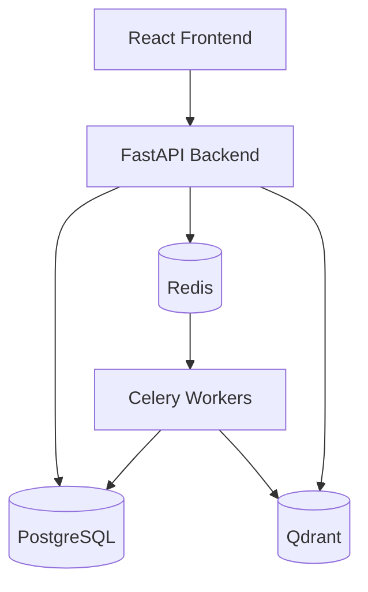

# RAGGuard Architecture

## High-Level Overview

RAGGuard follows a modern modular architecture, separating the client interface from the backend logic, and utilizing task queues for heavy asynchronous processing such as RAG evaluation.

## Components

### Frontend
- **Framework**: React + TypeScript powered by Vite.
- **Styling**: Tailwind CSS combined with shadcn/ui for consistent, accessible components.
- **State/Routing**: React Router for navigation and TanStack Query for data fetching and caching.

### Backend API
- **Framework**: FastAPI providing high performance and auto-generated OpenAPI documentation.
- **ORM**: SQLAlchemy 2.0 with async support (`asyncpg`).
- **Migrations**: Alembic for database schema version control.

### Services Layer
- **Evaluation**: Core logic for evaluating RAG outputs against expected baselines.
- **Guardrails**: Implementation of guardrails checks (e.g., toxicity, hallucination).
- **RAG**: Interfaces with Qdrant vector store for retrieval testing.

### Infrastructure
- **PostgreSQL**: Primary relational data store for configurations, users, baselines, and evaluation results.
- **Redis**: Message broker for Celery and caching layer.
- **Qdrant**: Vector database for storing and querying document embeddings.
- **Celery Workers**: Background processing for long-running evaluation jobs to avoid blocking the main API thread.

## Data Flow
1. User configures a guardrail through the Frontend.
2. Request is handled by FastAPI and stored in PostgreSQL.
3. An evaluation run is triggered. FastAPI enqueues a job in Redis.
4. Celery Worker picks up the job from Redis.
5. Worker runs the RAG pipeline (querying Qdrant) and evaluates responses.
6. Worker saves results back to PostgreSQL.
7. Frontend polls or receives SSE (future) for job completion and displays results.
